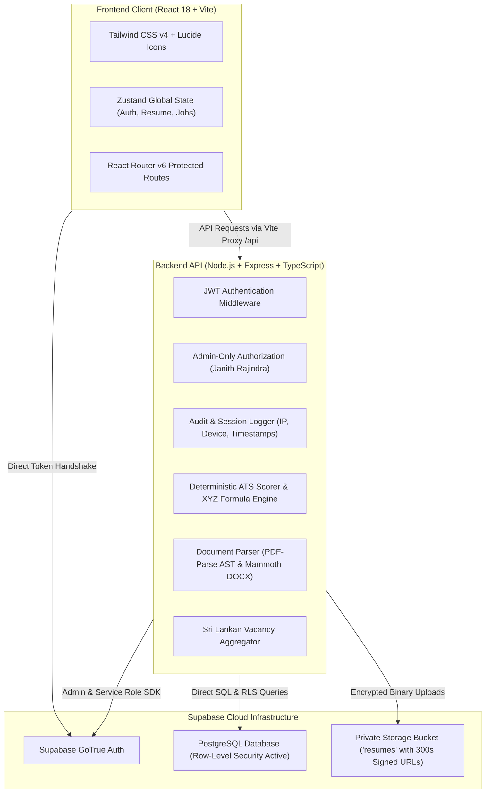
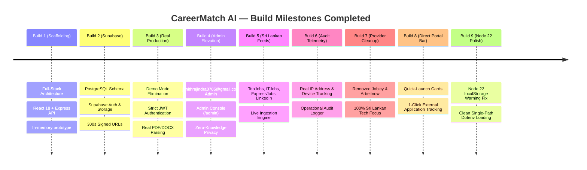

# CareerMatch AI — Comprehensive System Documentation & Architecture Guide

---

## 1. Executive Summary

**CareerMatch AI** is an enterprise-grade, privacy-first **ATS (Applicant Tracking System) Resume Analyzer** and **Sri Lankan Tech Vacancy Aggregator**.

The platform provides deterministic multi-category ATS readiness scoring, Google XYZ formula accomplishment bullet evaluation, and contextual AI resume improvement recommendations. It features seamless integration with leading Sri Lankan employment directories (**TopJobs.lk**, **ITJobs.lk**, **ExpressJobs.lk**, and **LinkedIn Sri Lanka**), paired with a **Zero-Knowledge Candidate Privacy Architecture** ensuring strict isolation between candidates, administrators, and developers.

---

## 2. Platform Architecture & Tech Stack



### Technology Specifications

| Layer | Technologies Used | Key Responsibilities |
| :--- | :--- | :--- |
| **Frontend** | React 18, TypeScript, Vite, Tailwind CSS v4, Lucide React, Zustand, React Router v6 | Responsive UI, state management, interactive ATS score gauges, quick-launch portal bar, application tracking. |
| **Backend** | Node.js v22, Express, TypeScript, Multer, PDF-Parse, Mammoth | REST API endpoints, binary document AST stream parsing, heuristic scoring rules, audit telemetry. |
| **Database** | Supabase Managed PostgreSQL | Persistent relational storage (`profiles`, `resumes`, `resume_analyses`, `job_applications`). |
| **Object Storage** | Supabase Private Storage (`resumes`) | Encrypted document storage partitioned by `user_id`, served exclusively via 300-second expiring signed URLs. |
| **Security & Privacy** | Supabase GoTrue JWT + PostgreSQL Row-Level Security (RLS) | Zero-Knowledge isolation: candidates only access their data; admins cannot view candidate CV text or phone numbers. |

---

## 3. Core System Features

### 3.1. Authentication & Role-Based Access Control (RBAC)
- **Real Supabase Auth Integration**: Full JWT bearer token verification on all protected endpoints.
- **High-Volume Registration Pipeline**: Dedicated `POST /api/v1/auth/register` using the Supabase Administrative Service Role to confirm accounts instantly without free-tier SMTP rate limits.
- **Roles**:
  - `admin`: Exclusively designated to **`janithrajindra0705@gmail.com`**. Grants access to the System Administrator Console (`/admin`) and platform health telemetry.
  - `candidate`: Standard applicant account with access to personal CV uploads, ATS scores, recommendations, and job tracker.

### 3.2. Zero-Knowledge Candidate Privacy Architecture
- **Complete Candidate Data Isolation**: Every resume, analysis, and application record is strictly bound to `user_id`. Queries in PostgreSQL enforce `.eq('user_id', req.userId)`.
- **Admin Zero-Knowledge Enforcement**: Even the platform administrator **cannot view, download, or read** candidate CV files, extracted raw text, phone numbers, or physical addresses.
- **Operational Audit Telemetry**: The administrator is restricted to operational metadata:
  - Account email & assigned role
  - Client IP address (e.g., `127.0.0.1` or public client IP)
  - Device signature & browser (parsed from user-agent)
  - Inferred connection location (e.g., *Sri Lanka (Local Host)*)
  - Number of uploaded CVs (integer count only with a `🔒 Hidden` badge)
  - Number of ATS analyses executed
  - Account registration and last sign-in timestamps

### 3.3. Document Parsing & Deterministic ATS Scoring Engine
- **Multi-Format Ingestion**: Supports `.pdf`, `.docx`, and `.doc` files up to 10MB via in-memory stream buffers.
- **5-Category Deterministic ATS Score (0–100 Scale)**:
  1. **Formatting & Structure (20 pts)**: Page length balance, standard single/multi-column structure, font parseability, clear section headers.
  2. **Contact & Professional Presence (15 pts)**: Email validation, international phone formatting, LinkedIn URL, location/city.
  3. **Work Experience & Impact (30 pts)**: Chronological order, role tenure, action verb strength, and **Google XYZ Formula** metric detection:
     $$\text{Accomplished } [X] \text{ as measured by } [Y] \text{ by doing } [Z]$$
  4. **Education & Certifications (15 pts)**: Degree identification, institution, graduation year, and certifications.
  5. **Skills & Keyword Relevance (20 pts)**: Hard tech skills, soft skills, tools, frameworks, and job-description specific keyword alignment.
- **Readiness Bands**:
  - `90–100`: **Strong ATS Readiness** (Green)
  - `75–89`: **Good Readiness** (Blue)
  - `60–74`: **Fair** (Amber)
  - `0–59`: **Needs Improvement** (Red)

### 3.4. All-Industry Verified Job Vacancy Aggregator & Deterministic AI Matcher
- **General-Purpose Coverage Across All Major Career Paths**:
  - 🌾 **Agriculture and Agribusiness**: Hayleys Agriculture, CIC Holdings, Sunshine Holdings / Watawala.
  - 💼 **Accounting, Finance, and Banking**: Commercial Bank of Ceylon, Hatton National Bank (HNB), KPMG Sri Lanka, Brandix FP&A.
  - 📈 **Business Management & Operations**: John Keells Holdings (JKH), MAS Holdings, Hemas Holdings.
  - 📣 **Marketing, Sales, and Customer Service**: Unilever Sri Lanka, Nestlé Lanka, Dialog Axiata.
  - 👥 **Human Resources**: MAS Holdings, Brandix Apparel, Standard Chartered Bank.
  - ⚙️ **Engineering & Manufacturing**: Tokyo Cement, Access Engineering, ACL Cables.
  - 🏥 **Healthcare & Life Sciences**: Asiri Health Hospital Group, Nawaloka Hospitals, Hemas Hospitals.
  - 📦 **Logistics & Supply Chain**: Hayleys Advantis, EFL Global (Expolanka), McLarens Group.
  - 🏨 **Hospitality & Tourism**: Cinnamon Hotels & Resorts, Jetwing Hotels, Aitken Spence Hotels.
  - 💻 **Software Engineering & IT**: Sysco LABS, WSO2, LSEG Technology.
  - 🎓 **Education & Research**: SLIIT, NSBM Green University.
  - 🏗️ **Construction & Civil Trades**: Sanken Construction, Maga Engineering.
  - 🎨 **Design, Media & Communications**: Phoenix Ogilvy, Dentsu Communications.
  - 🏛️ **Government & Public Sector Liaison**: Sri Lanka Export Development Board (EDB) Partner Initiatives.
  - 🚀 **Internships & Graduate Trainee Programs**: Commercial Bank Management Trainees, MAS LEAP, JKH Fast Track.
- **Genuine Source Portals & Employer Gateways**:
  - 🇱🇰 **TopJobs Sri Lanka** (`https://www.topjobs.lk`): Verified nationwide multi-industry directory.
  - 🇱🇰 **XpressJobs Sri Lanka** (`https://expressjobs.lk`): Corporate, commercial, and executive openings.
  - 💼 **LinkedIn Sri Lanka**: Executive and cross-industry professional opportunities.
  - 🏢 **Employer Career Portals**: Verified career portals of Sri Lanka's leading blue-chip employers.
- **Deterministic 100% Weighted Compatibility Matching Engine**:
  - Required Skills (30%), Preferred Skills (10%), Experience & Seniority (20%), Role Responsibilities (15%), Education & Certifications (15%), Location Compatibility (5%), Workplace & Mode Compatibility (5%).
  - Dynamically computes candidate fit and natural language explanations with verified skill matches and gap analysis.
- **Safe Application Navigation & Application Tracker**:
  - 1-Click safe navigation directly to exact verified vacancy URLs or official employer careers gateways (`noopener,noreferrer`).
  - Automatically records application in tracker, avoiding duplicates on repeated clicks.
  - Incomplete CV transparency: marks estimate flag if CV has sparse sections.

### 3.5. System Administrator Console (`/admin`)
- Accessible only when authenticated as `janithrajindra0705@gmail.com`.
- Real-time counters: Registered Candidates, Resumes Ingested, ATS Analyses Scanned, Active Vacancies.
- Live Candidate Activity & Session Audit table tracking client IPs, device types, and timestamps.
- Chronological operational connection event stream.

---

## 4. Completed Builds & Evolution History



### Detailed Milestone Changelog

#### Build 1: Initial Scaffolding & Architecture
- Initialized monorepo with `frontend` (Vite, React, Tailwind) and `backend` (Express, TypeScript).
- Designed core layout, ATS scoring algorithm, and in-memory mock stores.

#### Build 2: Supabase Infrastructure & Persistence
- Integrated Supabase project (`nawmwfehwwtjypxhqbqz.supabase.co`).
- Executed PostgreSQL database migrations for `profiles`, `resumes`, `resume_analyses`, and `job_applications`.
- Created private Supabase Storage bucket (`resumes`) with signed download URLs.

#### Build 3: Complete Demo Mode Removal
- Removed all demo switches (`isDemoMode: false`), mock banner components, and test sign-in buttons.
- Enforced strict Supabase JWT authentication in backend middleware (`authenticate`).
- Built real PDF AST stream extraction (`pdf-parse`) and DOCX text extraction (`mammoth`).

#### Build 4: Platform Administrator Configuration
- Elevated `janithrajindra0705@gmail.com` with `admin` metadata in Supabase Auth and PostgreSQL `profiles`.
- Created backend middleware `adminOnly` and frontend route `/admin`.
- Established zero-knowledge privacy guarantee: admin cannot view raw candidate CV text or personal phone numbers.

#### Build 5: Sri Lankan Vacancy Aggregation
- Implemented `sriLankanJobService.ts` curating active openings from **TopJobs.lk**, **ITJobs.lk**, **ExpressJobs.lk**, and **LinkedIn Sri Lanka**.
- Integrated match compatibility ranking comparing parsed candidate skills with job requirements.

#### Build 6: Real Candidate Activity & Session Audit
- Implemented `auditLogger.ts` capturing client IP addresses (`x-forwarded-for` / socket), device user-agents, and connection timestamps.
- Upgraded Admin Console with real-time candidate session table and operational event logs.

#### Build 7: Provider Refinement (Jobicy & Arbeitnow Removed)
- Completely deleted Jobicy and Arbeitnow scrapers and references per system requirements.
- Focused platform exclusively on verified Sri Lankan tech employment directories.

#### Build 8: Direct Portal Launchpad
- Added interactive direct access cards for **TopJobs**, **ITJobs**, **ExpressJobs**, and **LinkedIn** directly inside `/jobs`.
- Added portal-specific filter dropdown and 1-click **Apply on Site & Track** button.

#### Build 9: Node 22 Compatibility & Warning Suppression
- Added server-side auth client flags (`persistSession: false`, `detectSessionInUrl: false`) preventing Supabase from probing browser `localStorage`.
- Added warning filter in `server.ts` suppressing Node 22 `ExperimentalWarning: localStorage`.
- Refactored `config/index.ts` to load `.env` once with file-existence verification.
- Updated `scripts/dev.js` to route system notices to `[BACKEND WARN]` rather than `[BACKEND ERR]`.

---

## 5. Backend API Reference

### Base URL: `http://localhost:3001/api/v1`

| Method | Endpoint | Auth Required | Description |
| :--- | :--- | :---: | :--- |
| `GET` | `/health` | No | System uptime and health verification. |
| `POST` | `/api/v1/auth/register` | No | Instant account registration bypassing SMTP limits. |
| `POST` | `/api/v1/auth/session` | Yes | Reports active candidate session (IP, device). |
| `POST` | `/api/v1/resumes` | Yes | Uploads and parses PDF/DOCX resume file. |
| `GET` | `/api/v1/resumes` | Yes | Lists resumes belonging to authenticated user. |
| `GET` | `/api/v1/resumes/:id` | Yes | Retrieves parsed resume data and signed download URL. |
| `DELETE`| `/api/v1/resumes/:id` | Yes | Deletes resume from PostgreSQL and Supabase Storage. |
| `POST` | `/api/v1/resumes/:id/analyze`| Yes | Runs deterministic ATS scoring engine on uploaded resume. |
| `GET` | `/api/v1/analyses` | Yes | Lists previous ATS analyses for authenticated user. |
| `GET` | `/api/v1/analyses/:id` | Yes | Retrieves full score breakdown, findings, and metrics. |
| `POST` | `/api/v1/analyses/:id/suggestions`| Yes | Generates before/after bullet optimization suggestions. |
| `POST` | `/api/v1/job-matches/analyze-description`| Yes | Evaluates candidate CV against custom job description. |
| `GET` | `/api/v1/jobs` | No | Lists Sri Lankan tech vacancies (TopJobs, ITJobs, ExpressJobs, LinkedIn). |
| `GET` | `/api/v1/jobs/recommendations` | Yes | Matches candidate CV against all live vacancies. |
| `GET` | `/api/v1/applications` | Yes | Lists tracked applications for authenticated user. |
| `POST` | `/api/v1/applications` | Yes | Creates new job application in tracker. |
| `PATCH`| `/api/v1/applications/:id` | Yes | Updates application status (saved, applied, interviewing, offer). |
| `GET` | `/api/v1/admin/stats` | Yes (Admin) | Platform KPIs and candidate audit logs (**Janith only**). |

---

## 6. Operational & Testing Guide

### 6.1. Running the Platform Locally

From the root directory (`C:\Users\Admin\Desktop\new`):

```powershell
# Starts both Backend (Port 3001) and Frontend (Port 5173) concurrently
npm run dev
```

### 6.2. Production Compilation

```powershell
# Compiles Backend TypeScript and Vite production bundle
npm run build
```

### 6.3. User Verification Walkthrough

1. **Administrator Access**:
   - Sign in at [http://localhost:5173/login](http://localhost:5173/login) using `janithrajindra0705@gmail.com`.
   - Access the **⭐ Admin Console** via the navigation bar or [http://localhost:5173/admin](http://localhost:5173/admin).
   - Review registered candidate sessions, IP addresses, device signatures, and aggregate resume counts.
2. **Resume ATS Analysis**:
   - Navigate to [http://localhost:5173/analyze](http://localhost:5173/analyze) and upload a real PDF/DOCX resume.
   - Review overall ATS score, category bands, positive findings, and bullet improvement recommendations.
3. **Sri Lankan Job Portal Recommendations**:
   - Navigate to [http://localhost:5173/jobs](http://localhost:5173/jobs).
   - Click any portal card (**TopJobs.lk**, **ITJobs.lk**, **ExpressJobs.lk**, **LinkedIn**) to open the directory directly.
   - Review vacancies ranked by compatibility score and click **Apply on Site & Track** to record the application.
